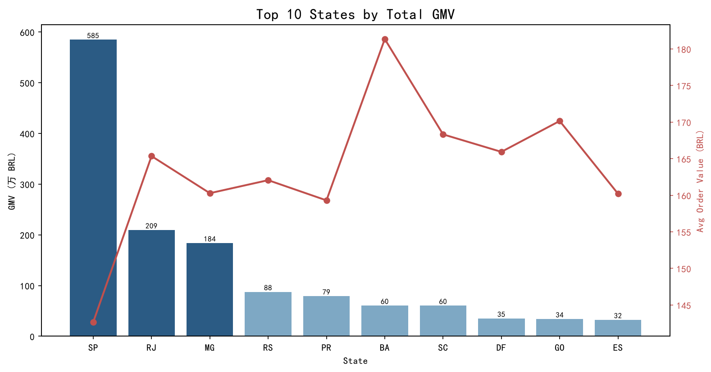
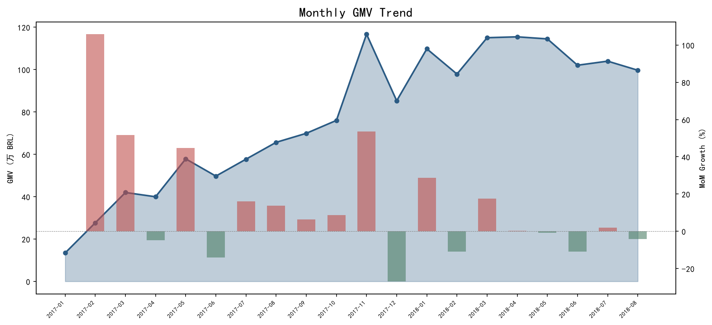
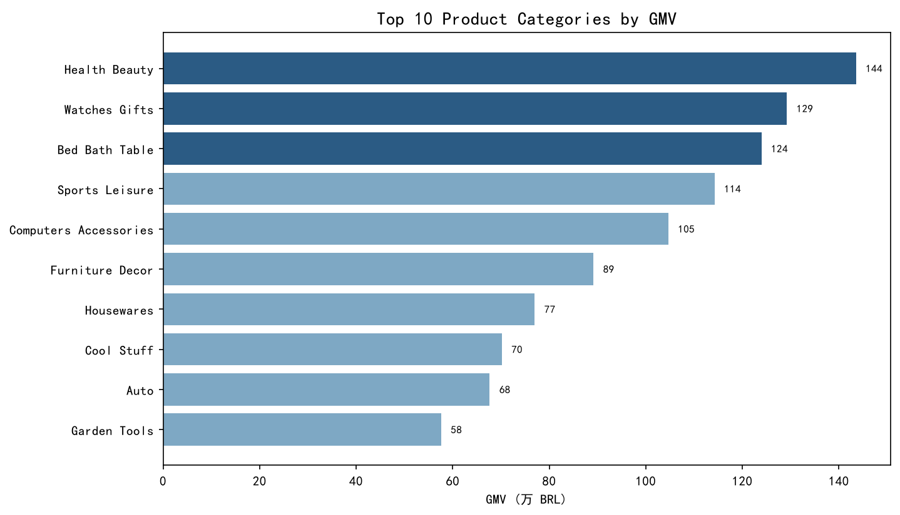
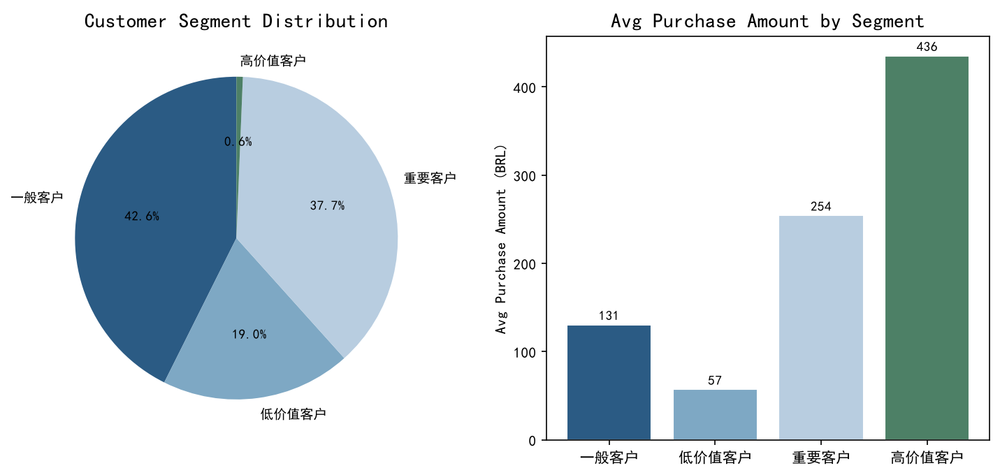

# 基于 PySpark 的电商经营分析与用户价值分层

[](https://github.com/MimiQuark/Olist-Ecommerce-RFM-Analysis/actions/workflows/ci.yml)
[](https://github.com/MimiQuark/Olist-Ecommerce-RFM-Analysis)
[](https://spark.apache.org/docs/latest/api/python/)
[](LICENSE)

基于 Kaggle 公开的巴西电商 Olist 数据集（2016–2018 年，约 10 万条订单记录），使用 **PySpark** 完成从数据清洗、指标计算到 RFM 客户分层的全链路经营分析，围绕区域、趋势、品类、客户结构四个维度输出经营结论，并以 Matplotlib 生成可视化分析报告。

数据集：[Brazilian E-Commerce Public Dataset by Olist](https://www.kaggle.com/datasets/olistbr/brazilian-ecommerce)（下载解压后放入 `data/` 目录）。仓库不提交原始压缩包（Kaggle 页面标注约 44.7 MB）。

> 数据许可：Olist 数据集采用 **CC BY-NC-SA 4.0**，仅限非商业使用并需署名/同条件共享；本仓库代码采用 MIT。两者许可范围不同，请勿将数据用于商业用途。  
> 本次复现使用 Kaggle 数据集 `olistbr/brazilian-ecommerce` 版本 2（2026-10-21 下载）。

## 项目内容导航

- [可视化与可解释性](docs/VISUAL_GUIDE.md)：4 个以上 Mermaid 思维导图、流程图和指标解释

- [项目案例研究](docs/CASE_STUDY.md)：指标口径、双层宽表、RFM 设计、核心结论和面试讲解
- [分析主脚本](analysis.py)、[可视化脚本](visualize.py)
## 分析内容

| 模块 | 说明 |
|---|---|
| 数据建模 | 订单、订单商品、商品、客户、支付、品类翻译 6 表关联，分别构建订单级与商品行级双层宽表 |
| 数据清洗 | 金额类型转换、多格式时间戳兼容解析、过滤无效订单状态、支付金额按订单聚合并剔除异常金额（含剔除日志） |
| 区域分析 | 各州 GMV / 订单量 / 客单价排名 |
| 趋势分析 | 月度 GMV 走势与环比增速（窗口函数 lag） |
| 品类分析 | 商品类目 GMV 排名（葡语类目名翻译为英文，商品行口径） |
| RFM 分层 | 以真实客户 ID 按最近消费、频次、金额打分，分为高价值 / 重要 / 一般 / 低价值四层 |

## 核心结论

- **区域高度集中**：圣保罗州（SP）GMV 约 585 万 BRL、4.1 万单，是第二名里约州（RJ，209 万）的约 2.8 倍；头部三州（SP/RJ/MG）贡献全平台约 62% 的营收
- **品类格局**：健康美妆（health_beauty，144 万 BRL）、手表礼品（watches_gifts，129 万）、床品卫浴（bed_bath_table，124 万）为 GMV 前三类目；手表礼品在 GMV 前十类目中件均价最高（约 218 BRL，含运费）
- **增长趋势**：2017 年起月度 GMV 进入稳定增长通道，2017 年 11 月（黑五）单月 GMV 达 116.7 万 BRL 峰值；2018 年 1–8 月月均约 107.3 万 BRL（2 月、8 月略低于 100 万；9 月为不完整月），整体客单价约 160 BRL
- **客户结构**：以 `customer_unique_id` 识别真实客户 9.47 万人，复购率仅 3.0%，拉新强、留存弱；RFM 分层显示高价值客户 603 人，人均消费 436 BRL，是低价值客户（57 BRL）的 7 倍以上

## 实现要点

- **GMV 口径拆分**：区域 / 趋势 / RFM 分析基于订单级宽表（一行一订单），品类分析基于商品行级宽表（GMV = price + freight_value），避免订单支付额在多商品订单中被重复累加
- **真实客户识别**：Olist 的 `customer_id` 为一次性订单级 ID，RFM 按 `customer_unique_id` 聚合才能得到真实的频次与复购率
- **混合打分**：R / M 维度采用四分位（ntile）打分，并以 `customer_unique_id` 作为二级排序键，保证同值客户在不同 Spark 环境下分层一致；F 维度高度集中于 1 次，改用阈值打分（≥4 / 3 / 2 / 1 次对应 4 / 3 / 2 / 1 分）
- **时间戳兼容**：同时兼容 Kaggle 原版（`yyyy-MM-dd`）与部分镜像（`yyyy/MM/dd`）两种时间格式，并输出解析失败行数自检
- **趋势图口径**：趋势图只绘制 2017-01 至 2018-08 的完整月份；月度 CSV 保留 2016-09–2018-09 全部月份，缺失月份（如 2016-11）保留为空行，`mom_growth_pct` 为 null，不再跨缺月计算环比

## 成果展示

| 各州 GMV Top 10 | 月度趋势 |
|---|---|
|  |  |

| 品类排名 | RFM 客户分层 |
|---|---|
|  |  |

## 文件说明

| 文件 | 说明 |
|---|---|
| `analysis.py` | PySpark 分析主脚本（Spark SQL / DataFrame API），输出分析结果 CSV 到 `output/` |
| `visualize.py` | 读取分析结果，生成 4 张图表到 `output/charts/` |
| `data/` | 数据集（需自行从 Kaggle 下载，见上方链接） |
| `output/` | 分析结果 CSV 与图表成品 |

## 复现方式

前置条件：Python 3.10–3.12（PySpark 3.5 尚未支持 Python 3.13+），以及 Java 8/11/17（PySpark 运行时依赖；`java -version` 可用即可）。

```bash
pip install -r requirements.txt
# 从 Kaggle 下载并解压以下 6 个 CSV 到 data/：
#   olist_orders_dataset.csv
#   olist_order_items_dataset.csv
#   olist_products_dataset.csv
#   olist_customers_dataset.csv
#   olist_order_payments_dataset.csv
#   product_category_name_translation.csv
python analysis.py    # PySpark 分析，生成本地 Spark 会话即可运行
python visualize.py   # 生成图表
```

> Windows 下运行时出现 `winutils.exe` / `native-hadoop` 相关 WARN 属正常现象，不影响结果。

## 验证

```bash
python -m pytest -q
```

4 项测试直接校验已提交的 `output/` CSV：州级排名与头部占比、月度覆盖范围、品类前三、RFM 四层客户数与高/低价值客群指标。这些是产物快照回归，不执行 PySpark 计算；CI 目前也无法发现 Spark 逻辑本身的回归。

## 工具

PySpark（Spark SQL / DataFrame API）· Pandas · Matplotlib
